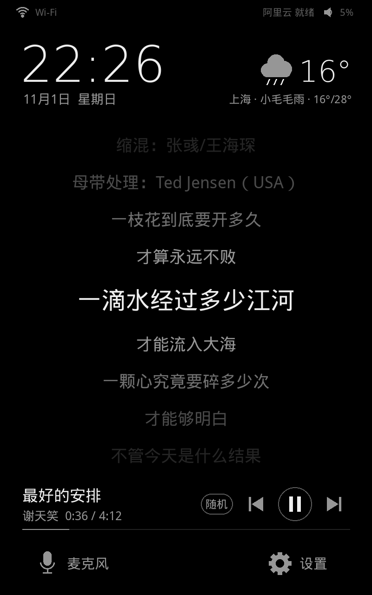
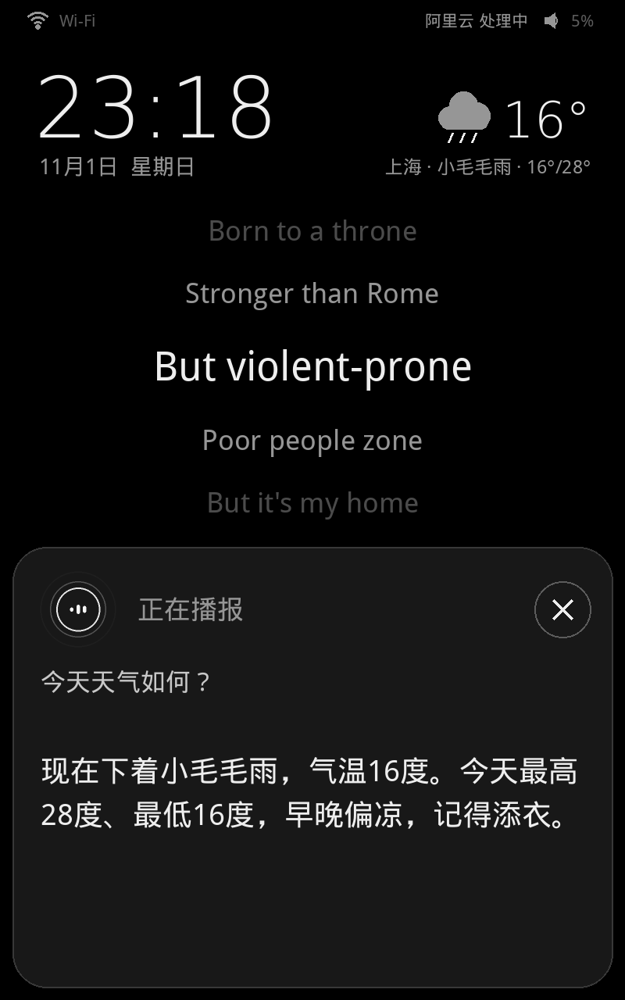
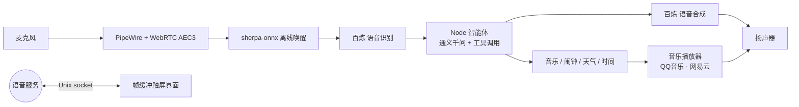

# ThinkSmart View Assistant

**把吃灰的 Lenovo ThinkSmart View 变成一台中文智能音箱：语音对话、点歌、歌词、闹钟、天气，全部跑在设备自己的 Linux 上。**

[](LICENSE)

-orange)


ThinkSmart View 原本是一台 Zoom/Teams 会议屏，退役后大多在吃灰。它有 8 英寸触摸屏、麦克风和不错的扬声器，很适合当智能音箱用。这个项目在设备刷上 Ubuntu 后，补齐了音频驱动、回声消除、语音助手和触屏界面，开机就能直接对它说话。

<table>
  <tr>
    <td align="center"><br>待机：时钟、天气、唤醒提示</td>
    <td align="center"><br>播放：滚动歌词、播放模式、控制按钮</td>
    <td align="center"><br>对话：底部浮动卡片，不挡歌词</td>
  </tr>
</table>

## 能做什么

- **语音唤醒，随时打断**：本地离线唤醒词（默认"小爱同学"，可以在屏幕上改成任意 2 到 8 个汉字）。放歌时也能唤醒，因为音乐会通过 WebRTC AEC3 回声消除从麦克风里减掉。
- **大模型对话**：语音识别、对话、语音合成都用阿里云百炼（通义千问），支持联网搜索新闻、比分、行情，回答简短，适合直接念出来。
- **自然的多轮对话**：对话以底部浮动卡片显示，歌词和时钟不被遮挡。播歌、调音量这类指令执行完立即结束；助手反问时多等几秒听回答；普通回答后留一个短暂的追问窗口，没人说话就收起卡片。
- **点歌和收藏**：说"播放周杰伦的晴天""放我喜欢的歌"就行。QQ 音乐扫码登录后能播会员歌曲，放不了的歌会自动去网易云找免费的同名版本。
- **播放模式**：随机（默认）、顺序、单曲循环，用语音或点屏幕上的按钮切换，重启后也会记住。
- **滚动歌词**：歌词随播放进度逐行高亮。
- **闹钟、倒计时、提醒**：支持"工作日早上七点叫我""二十分钟后提醒我关火"这类说法，也可以查看和取消。
- **时间和天气**：屏幕常显时钟和天气（数据来自 Open-Meteo），城市可以在设置里搜索切换。
- **断网也能用**：没有网络时，仍能离线识别音量、暂停、切歌、几点了、今天几号等常用指令。
- **触屏设置**：音量、亮度、语速、唤醒词、城市、麦克风开关、思考模式、自动调暗，内置拼音输入法。

## 架构



| 目录 | 内容 |
| --- | --- |
| `device/voice/` | 语音助手主程序、音乐、闹钟、天气、离线指令，以及安装脚本 |
| `device/agent/` | 基于 `@earendil-works/pi-ai` 的大模型智能体，用 esbuild 打包成单个文件 |
| `device/ui/` | 直接画在 `/dev/fb0` 上的触屏界面，不依赖桌面环境 |
| `device/audio/` | 声卡 UCM、WirePlumber、回声消除配置，以及 AEC3 插件构建脚本 |
| `device/clock/` | 设备的硬件时钟不保留真实时间，这里定期保存时间，开机后在联网校时前先恢复 |
| `*.ps1` / `*.cmd` | Windows 上一键 SSH 登录、配置密钥、修改唤醒词的脚本 |

## 准备

- 一台 **Lenovo ThinkSmart View（CD-18781Y，高通 msm8953 平台）**，并已按 [rickx/ubuntu-thinksmart](https://github.com/rickx/ubuntu-thinksmart) 刷好 Ubuntu。设备上要有用户 `thinksmart`（uid 1000），并且能免密 `sudo`。
- 一个 [阿里云百炼](https://bailian.console.aliyun.com/) 的 API Key 和 Workspace ID（北京地域）。
- 可选：一个 QQ 音乐账号。不登录时只能播网易云的免费歌曲。

## 安装

1. **音频**（只需做一次）
   - 在电脑上运行 `device/audio/build-aec3.sh`，交叉编译回声消除插件，产物在 `outputs/audio/`。它需要 WebRTC Audio Processing 1.3 和 PipeWire 1.0.5 的源码，放在 `tools/` 下。
   - 把与设备内核匹配的 `snd-soc-tas5782m.ko` 和功放 DSP 固件 `tas5728m_dsp_lenovo_cd-18781y.bin` 放进 `device/audio/`。固件来自原厂系统，本仓库不分发。
   - 把整个仓库复制到设备上，运行 `sudo device/audio/install.sh`。

2. **打包智能体**（在电脑或设备上都可以）

   ```sh
   cd device/agent && npm install && npm run build
   ```

3. **安装语音助手和界面**

   ```sh
   sudo device/voice/install.sh
   ```

   这一步会安装 Node 22、Python 依赖、唤醒词模型、systemd 服务，并启动触屏界面。

4. **填入百炼密钥**。在设备上执行下面的命令，执行完删掉 JSON 文件：

   ```sh
   sudo thinksmart-configure-voice < aliyun.json
   # aliyun.json: {"api_key": "sk-...", "workspace_id": "...", "region": "cn-beijing"}
   ```

   用 Windows 的话也可以运行 `Configure-ThinkSmartVoice.ps1`，它会隐藏输入，再通过 SSH 写入设备。

5. **登录 QQ 音乐（可选）**：在屏幕上进入 设置 → QQ音乐，用 QQ 音乐 App、QQ 或微信扫码登录。

> Windows 脚本默认用 `.local/ssh/` 下的密钥连接 `thinksmart@192.168.0.107`，用之前把地址改成你设备的 IP。

## 试试这样说

| 说法 | 效果 |
| --- | --- |
| 小爱同学，播放陈奕迅的十年 | 搜索并播放，搜索结果放完后接着放推荐歌曲 |
| 放我喜欢的歌 / 随机播放 / 单曲循环 | 播放 QQ 音乐收藏，或切换播放模式 |
| 下一首 / 暂停 / 声音大一点 | 本地直接执行，不需要经过大模型 |
| 明天早上七点叫我起床 | 设置闹钟，到点响铃，说"停止闹钟"关掉 |
| 后天北京会下雨吗 | 查询天气 |
| 今天有什么科技新闻 | 联网搜索后用一两句话概括 |
| 没事了 / 晚安 | 结束对话；说"晚安"会同时关掉屏幕 |

## 配置

- `/etc/thinksmart-voice.conf`：语音识别、对话、语音合成用的模型和音色，唤醒灵敏度，回复长度。
- `/etc/thinksmart-ui.conf`：默认城市和经纬度、天气刷新间隔、自动调暗时间。
- 屏幕上的设置会自动保存，不用手动改文件。

## 接入新的音乐平台

音乐平台都实现同一个 `Source` 接口（见 `device/voice/music.py`），播放器不关心歌从哪里来：

```python
class MyPlatform(Source):
    name = "my"
    label = "我的平台"

    def search(self, keyword, limit=20): ...   # 返回 [{"src": "my", "id": ..., "title": ..., "artist": ..., "dur": ...}]
    def stream(self, track): ...               # 返回 (mp3_url, headers)
    def lyric(self, track): ...                # 可选，返回 LRC 文本
```

写完后加到 `MusicService.sources` 里。某个平台放不了或没有歌词时，会自动去其他平台找同一首歌。注意解码器目前只能播 MP3；要接入喜马拉雅、YouTube Music 这类 AAC 或 Opus 音源，得先换成 ffmpeg 一类的解码器。欢迎提 PR。

## 致谢

[rickx/ubuntu-thinksmart](https://github.com/rickx/ubuntu-thinksmart) ·
[sherpa-onnx](https://github.com/k2-fsa/sherpa-onnx) ·
[WebRTC Audio Processing](https://gitlab.freedesktop.org/pulseaudio/webrtc-audio-processing) ·
[PipeWire](https://pipewire.org/) ·
[qqmusic-api-python](https://pypi.org/project/qqmusic-api-python/) ·
[Open-Meteo](https://open-meteo.com/) ·
[阿里云百炼](https://bailian.console.aliyun.com/)

## 免责声明

本项目与联想、腾讯、网易、阿里云都没有关系。刷机有让设备变砖的风险，请先完整备份原厂分区。音乐内容的版权归各平台和权利人所有，请遵守相应平台的用户协议。

## 许可证

[MIT](LICENSE)
